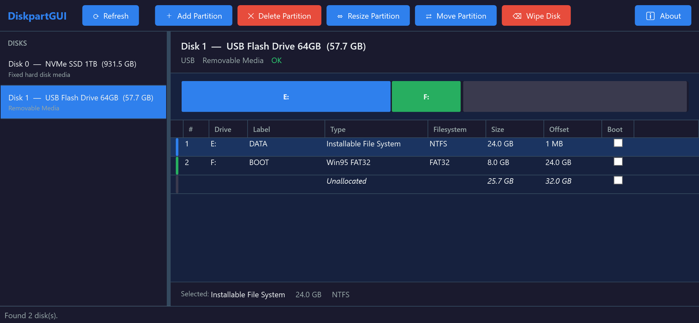

# DiskpartGUI

A modern Windows desktop application providing a graphical interface for the Windows `diskpart` utility and raw disk I/O. View all physical disks and their partitions, and add, delete, resize and move partitions or wipe a whole disk — without touching the command line.




**Disclaimer:** This project is generated using AI! You are responsible for your own data - backup anything of value before using this, or any tool that might be destructive!

---

## Features

- **View all physical disks** with model, exact size, interface type, and status
- **Visual partition bar** — proportional color-coded representation of each disk's layout, including unallocated regions
- **Every partition, numbered as diskpart sees it** — partition numbers match diskpart and Disk Management, and partitions WMI hides (such as the 16 MB Microsoft Reserved partition) are listed instead of showing up as free space
- **Unallocated space** — usable free regions are shown in both the disk bar and the partition list; the reserved areas at the start and end of the disk are never counted as free
- **Partition details** — drive letter, label, filesystem, size, offset, and boot flags
- **Add partition** — create a primary partition in the largest free region with configurable size, label, and filesystem (NTFS / FAT32 / exFAT); the size and label are checked against the filesystem's limits (FAT32 ≤ 32 GB, 11-character FAT labels) before anything is created
- **Delete partition** — with protection for system/boot partitions and a force-override option
- **Resize partition** — shrink or extend with a real-time shrink limit from `shrink querymax` (prevents silent partial shrinks caused by unmovable files like `pagefile.sys` or VSS snapshots); extend uses raw Win32 IOCTLs to bypass the VDS cache and is offered for NTFS volumes with a drive letter
- **Move partition** — physically relocates a partition's data using raw sector I/O, checked against the live partition table first (see the safety model below); cancelling mid-copy leaves the source partition intact
- **Wipe disk** — removes every partition on a disk (`diskpart clean`), leaving it empty and uninitialized; lists what will be erased, requires explicit confirmation, and refuses the disk Windows is running from
- **Clear errors** — diskpart's own error message is shown when an operation fails, instead of a false "success"
- **Progress indicator** — while an operation runs, a progress overlay shows what is happening and all actions are disabled, so a second operation can't start on stale data
- **About dialog** — version, description, and GitHub link
- **Portable** — runs as a single `.exe` with no installation required

---

## Requirements

| | |
|---|---|
| **OS** | Windows 10 1809 (build 17763) or later |
| **Architecture** | x64 |
| **Privileges** | **Administrator** — required to run diskpart, query WMI, and perform raw disk I/O |
| **.NET runtime** | Not required for portable build (self-contained); required for framework-dependent builds |

> The application will prompt for UAC elevation on startup. This is required by diskpart and raw disk access.

---

## Download

Go to the [Releases](https://github.com/therealscienta/DiskpartGUI/releases) page and download:

- `DiskpartGUI-vX.X.X-portable-win-x64.zip` — extract and run `DiskpartGUI.exe`, no installation needed

---

## Building from Source

### Prerequisites

- [.NET 10 SDK](https://dotnet.microsoft.com/download/dotnet/10)
- Windows 10/11 (WPF requires Windows)
- Visual Studio 2022 (optional — VS Code + CLI also works)

### Build

```powershell
dotnet restore DiskpartGUI.sln
dotnet build DiskpartGUI.sln --configuration Release
```

### Run

```powershell
# Must run as Administrator
dotnet run --project src/DiskpartGUI/DiskpartGUI.csproj
```

### Publish portable single exe

```powershell
dotnet publish src/DiskpartGUI/DiskpartGUI.csproj `
  --configuration Release `
  --runtime win-x64 `
  --self-contained true `
  -p:PublishSingleFile=true `
  --output ./publish/portable
```

> The output directory will contain `DiskpartGUI.exe` plus a small set of WPF native DLLs (`wpfgfx_cor3.dll`, `D3DCompiler_47_cor3.dll`, etc.) that must be kept alongside the exe.

---

## Running Tests

```powershell
# Unit tests (what CI runs)
dotnet test tests/DiskpartGUI.Tests/DiskpartGUI.Tests.csproj --configuration Release --filter "Category!=Integration"

# Everything, including integration tests that read (never write) this machine's real disks
dotnet test tests/DiskpartGUI.Tests/DiskpartGUI.Tests.csproj --configuration Release
```

---

## Architecture

```
src/DiskpartGUI/
├── Models/           Records: DiskInfo, PartitionInfo, FreeSpaceRegion, MoveProgress, …
├── Interop/          Win32 P/Invoke for raw disk I/O (NativeDisk.cs)
├── Services/         WMI disk reads + diskpart script execution + raw move service
├── ViewModels/       MVVM: MainViewModel, DiskItemViewModel, dialog VMs
├── Views/            WPF XAML: MainWindow, DiskDetailView, DiskBar, dialogs
├── Converters/       IValueConverter implementations
└── Resources/        Styles and colors
```

**Technology choices:**
- **WMI** (`Win32_DiskDrive`, `Win32_DiskPartition`, `Win32_LogicalDisk`) for structured disk reads, plus the **Windows Storage API** (`MSFT_Disk`, `MSFT_Partition`) for exact disk sizes, real partition numbers and partitions `Win32_DiskPartition` hides
- **diskpart.exe** via temporary script files (`diskpart /s <file>`) for add, delete, shrink, and wipe operations
- **Raw Win32 I/O** (`CreateFile`, `ReadFile`, `WriteFile`, `DeviceIoControl`) for move and extend — diskpart has no move command and its extend path goes through VDS, which caches stale layouts after raw partition moves
- **WPF + classic MVVM** with manual `ViewModelBase` and `RelayCommand` (no framework dependencies beyond `System.Management`)

**Move partition safety model:**
1. The move is checked against the disk's live partition table before anything is written: the destination must be aligned, unallocated space inside the usable area of the disk, and must not overlap the partition itself or any other partition (including hidden ones)
2. The volume is locked and dismounted before any writes, including volumes without a drive letter
3. All sectors are copied to the destination and flushed to the disk; only then is the partition table entry updated
4. Cancellation or failure during the copy leaves the source partition completely intact, and the dialog says exactly what state the disk was left in
5. Boot, system and Windows partitions can't be moved

---

## Safety Warning

Disk operations are **irreversible**. Deleting, resizing, moving partitions or wiping a disk can result in permanent data loss. Always back up important data before performing any disk operations.

The application displays warnings for system and boot partitions, requires explicit confirmation before any destructive action, and refuses to wipe the disk Windows is running from or to move boot, system and Windows partitions.

---

## Contributing

1. Fork the repository
2. Create a feature branch: `git checkout -b feature/my-feature`
3. Run tests: `dotnet test --filter "Category!=Integration"`
4. Commit and push
5. Open a Pull Request against `main`

Please ensure all unit tests pass before submitting a PR.

---

## License

[MIT](LICENSE)
